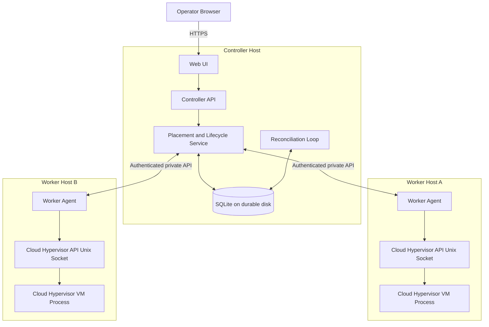

# Design — Minimal Two-Node Cloud Hypervisor VM Controller

## 1. Design goals

- Deliver a working provisioning interface quickly.
- Keep the control plane understandable and testable.
- Use Cloud Hypervisor rather than implementing a VMM.
- Avoid duplicate VM creation and unsafe capacity allocation.
- Make failure states visible instead of hiding uncertainty.
- Keep AWS deployment small, private by default, and cost-aware.

## 2. Proposed MVP stack

- **Language/runtime:** Go for controller and worker agents.
- **Web UI:** UI served by the controller; server-rendered HTML or a small embedded frontend to avoid a separate frontend deployment.
- **API:** JSON over HTTP for controller-to-worker and browser-to-controller communication; HTTPS at the exposed controller boundary.
- **Persistence:** SQLite stored on durable controller storage (EBS-backed disk when deployed on EC2).
- **Hypervisor:** Cloud Hypervisor, pinned to a tested release; local Unix socket on each worker.
- **Deployment:** systemd services on Linux hosts for the first prototype. Containers are optional and must not obscure KVM access or process ownership.
- **Testing:** Go unit tests, HTTP/API tests, fake worker tests, and KVM-backed end-to-end tests.

These are proposed defaults. Confirm repository conventions and actual host prerequisites before implementing.

## 3. Component architecture



## 4. Component responsibilities

### Controller API and UI

- Authenticate operator requests.
- Validate payloads and server-side image identifiers.
- Return VM records, worker status, operation progress, and useful errors.
- Never accept arbitrary shell fragments or unrestricted host paths.

### Placement and lifecycle service

- Select a worker based on capacity and current reservations.
- Create durable operation records.
- Reserve resources transactionally before dispatch.
- Dispatch commands to the selected worker.
- Update observed state only from confirmed worker results.

### SQLite metadata store

Suggested MVP tables:

- `workers`: worker ID, display name, endpoint, last heartbeat, last reported available memory, configured limit, status.
- `vms`: VM ID, name, worker ID, vCPU count, memory bytes, image ID, desired state, observed state, created/updated timestamps.
- `operations`: operation ID, VM ID, type, idempotency key, status, attempt count, error code/message, timestamps.
- `reservations`: VM ID, worker ID, reserved memory bytes, status, created/updated timestamps.
- Optional `settings`: safety reserve and prototype limits. Secrets should not be stored as plaintext settings.

Add appropriate unique constraints and indexes, especially for idempotency keys and active reservations.

### Worker agent

- Authenticate controller commands.
- Report heartbeat and resource inventory.
- Enforce local VM resource and image allowlists.
- Interact with the local Cloud Hypervisor API over a Unix socket.
- Track the Cloud Hypervisor process it starts and reap/clean up child processes correctly.
- Return observed state and structured errors.
- Never expose the VMM socket to the public network.

## 5. Placement policy

For worker (h), calculate the tracked safe capacity:

[
C_h = max(0,min(A_h-S_h, L_h-R_h))
]

Where:

- (A_h): latest host-available memory observation in bytes.
- (S_h): configured safety reserve.
- (L_h): configured reservation cap.
- (R_h): active and pending memory reservations.
- (C_h): safe capacity for a new request.

A host is eligible when it is healthy, its inventory is sufficiently fresh, and (C_h ge M), where (M) is requested VM memory. Select the eligible host with the largest (C_h); use a deterministic tie-breaker.

**Concurrency requirement:** selection and reservation must happen in a serialized database transaction or equivalent atomic operation. Re-check eligibility inside the transaction. If reservation fails due to a concurrent request, re-evaluate placement.

Capacity is an admission-control policy, not an exact prediction of host memory pressure. Use bytes internally and clearly define whether Linux available memory includes cache/reclaimable memory.

## 6. Lifecycle and operation model

Keep desired VM state separate from observed VM state.

Suggested VM states:
- `Defined`
- `Stopped`
- `Starting`
- `Running`
- `Stopping`
- `Failed`
- `Unknown`

Suggested operation states:
- `Pending`
- `Dispatched`
- `Succeeded`
- `Failed`
- `Unknown`

Typical start sequence:
1. Validate request and authenticate caller.
2. Create operation and reserve resources durably.
3. Dispatch operation ID and VM ID to the worker.
4. Worker checks whether that operation/VM already exists and queries Cloud Hypervisor.
5. Worker performs the operation and reports observed state.
6. Controller persists result and returns status.
7. If the response is lost, mark the operation uncertain and reconcile before another execution attempt.

Do not immediately release memory reservations for an uncertain operation. Release only after confirming that the VM did not start or is no longer consuming the reserved resources.

## 7. MVP API contract

Use a versioned prefix, JSON payloads, request timeouts, and consistent error objects.

| Method and path | Purpose |
|---|---|
| `GET /healthz` | Controller liveness |
| `GET /api/v1/workers` | Worker health and capacity |
| `GET /api/v1/vms` | List VM records and known state |
| `POST /api/v1/vms` | Define/prepare a VM; require an idempotency key |
| `GET /api/v1/vms/{id}` | VM details and state |
| `POST /api/v1/vms/{id}/start` | Start a defined/stopped VM |
| `POST /api/v1/vms/{id}/stop` | Stop a running VM |
| `GET /api/v1/operations/{id}` | Inspect operation progress/result |

A delete endpoint is optional and should not be added until cleanup semantics are clear. Create should not silently imply start: document whether it prepares a stopped VM and make the UI explicit.

### Example create request

```json
{
  "name": "demo-vm-01",
  "vcpus": 2,
  "memory_mib": 2048,
  "image_id": "ubuntu-demo"
}
```

The server resolves `image_id` through its allowlist. It does not accept a raw image filesystem path from the browser.

### Error semantics

- `400`: malformed or invalid request.
- `401/403`: missing/invalid credentials or insufficient permission.
- `404`: unknown VM or operation.
- `409`: invalid state transition, idempotency conflict, or capacity race that cannot be resolved.
- `422`: valid shape but unsupported VM resources/image.
- `503`: no healthy eligible worker or required worker unavailable.
- `202`: accepted asynchronous operation with an operation ID, if execution is not yet confirmed.

Return a stable machine-readable error code and a safe human-readable message.

## 8. Security model

- Expose only the controller HTTPS entry point to the operator's allowed IP range.
- Keep workers on a private subnet or otherwise restrict worker ingress to the controller security group/address.
- Authenticate worker requests using a prototype-appropriate secret or mTLS; store secrets in a protected file or AWS Secrets Manager/SSM where practical.
- Bind Cloud Hypervisor API to a Unix socket with restrictive ownership and permissions.
- Run services as dedicated non-root users where possible; grant only the permissions needed for KVM and VM resources.
- Use an allowlist of pre-staged images and fixed storage directories.
- Validate name, vCPU, memory, and image ID; enforce configured upper bounds.
- Avoid shell interpolation; use process APIs with argument arrays.
- Redact credentials from logs and errors.

## 9. AWS deployment shape

Preferred prototype topology, conditional on KVM feasibility:

- One small controller EC2 instance in a public subnet or private subnet behind a restricted access path.
- Two worker EC2 instances in private subnets, each with a tested KVM-capable configuration.
- Security groups allow operator HTTPS to controller and worker API traffic only from the controller.
- EBS-backed controller data directory for SQLite.
- CloudWatch logs/metrics optional for MVP; local structured logs are required.
- IAM instance roles with least privilege; no long-lived AWS access keys on hosts.
- Resource tags and a documented teardown procedure.

**Selected first candidate (not yet tested):** one temporary `c8i.xlarge` in `ap-south-1` (Mumbai), Ubuntu Server 24.04.5 LTS x86-64 host, Cloud Hypervisor v54.0, and the Ubuntu Server 24.04 LTS x86-64 cloud image build dated 2026-10-17. AWS documents nested virtualization for supported EC2 families, including C8i, and lists C8i in Mumbai; this establishes a plausible candidate, not runtime proof. The full preflight, signed checksum verification, boot/stop acceptance, and teardown steps are in [AWS worker feasibility gate](./deployment/aws-worker-validation.md).

**Feasibility gate:** Before provisioning both workers, prove that the candidate exposes working `/dev/kvm`, Cloud Hypervisor starts, and the exact guest boots and stops. If not, use a supported bare-metal configuration or another verified nested-virtualization-capable type. Do not assume nested KVM works on arbitrary EC2 instances.

## 10. Deployment and rollback

- Deploy versioned binaries and configuration to a test environment first.
- Run database migrations/backups before changing schema.
- Restart the controller and workers using systemd; verify health and logs.
- Keep the previous binary/configuration for rollback.
- Do not delete VM data or release uncertain reservations as part of rollback.
- Teardown AWS resources when the demo is complete, after preserving required evidence and artifacts.

## 11. Testing strategy

1. Unit tests: validation, placement math, tie-breaks, state transitions, idempotency-key rules.
2. Storage tests: atomic reservations, constraints, restart persistence.
3. API tests: authentication, malformed inputs, error semantics, operation polling.
4. Worker tests: fake Cloud Hypervisor API, timeout and process-exit behavior.
5. Integration tests: controller plus two simulated workers.
6. KVM end-to-end: actual create/start/stop/status on each validated host.
7. Fault injection: lost worker response, worker unavailable, controller restart, concurrent create, stale inventory.
8. Security checks: unauthenticated access, arbitrary image/path rejection, public worker endpoint denial.

## 12. Risks and mitigations

| Risk | Mitigation |
|---|---|
| AWS workers cannot access KVM | Test the exact instance configuration first; switch to supported bare metal or external KVM workers. |
| Cloud Hypervisor API differs by release | Pin version and test API calls against that version. |
| VM operation succeeds but response is lost | Persist operation IDs; query worker/VMM state before retry. |
| Reservation leaks after crash | Reconcile reservations against VM/process state; preserve uncertain reservations. |
| SQLite contention | Keep one controller writer, short transactions, and no network filesystem for the database. |
| Unsafe image or path input | Server-side image allowlist and fixed directories. |
| Prototype cost grows unexpectedly | Budget alerts, tags, short-lived workers, and teardown checklist. |
